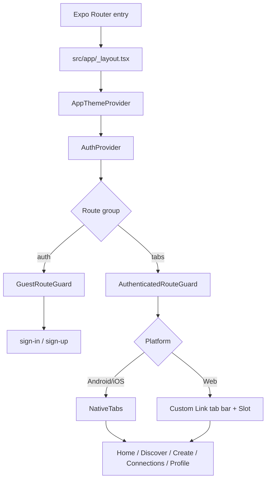
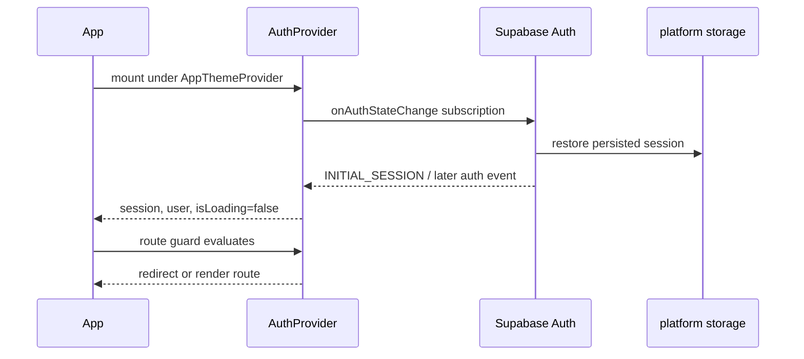
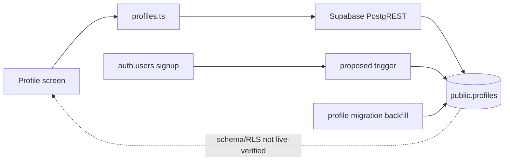

# Architecture and data flow

This describes the checked-out implementation, not the older aspirational architecture in `plan.md`. Current code uses Supabase, not Clerk/Convex. Route structure and data-backed features are in active uncommitted work; inspect Git state before editing.

## Startup and route flow

The root stack is declared in `src/app/_layout.tsx`. The auth group is visible only without a session; the tabs group waits for auth restore and redirects signed-out users. Native uses Expo Router `NativeTabs`; web resolves `src/app/(tabs)/_layout.web.tsx`, whose tab bar follows screen content in the layout rather than overlaying it. `AppScreen` provides safe-area top handling, scroll, max-width, and spacing.

**Route uncertainty:** `src/app/index.tsx` and `src/app/(tabs)/index.tsx` both declare Home for the canonical `/` path because route groups are not URL segments. The two implementations differ. The tab-group Home has an `AuthenticatedRouteGuard` at its parent; the root Home does not. Source inspection alone does not prove which route Expo Router selects for `/` in every platform/build. Verify the route manifest, direct URL, signed-out navigation, and redirects before deleting or moving either route. Do not assume `/` is protected just because `(tabs)` has a guard.

## Authentication lifecycle

- `src/auth/AuthProvider.tsx` owns one auth listener. It waits for Supabase's `INITIAL_SESSION`, so guards show a restoring state rather than immediately redirecting during storage read.
- On native, provider watches `AppState` and starts/stops Supabase auto-refresh according to foreground/background. On web it removes the auth listener on unmount; Supabase web behavior handles refresh.
- `src/components/auth/AuthScreen.tsx` normalizes email, performs lightweight email/password validation and confirmation-password matching on sign-up, and calls `signUp` or `signInWithPassword`. A signup response without a session shows confirmation instructions. It maps common invalid credentials, unconfirmed email, rate-limit, password, and network errors to user-facing text.
- Sign-out is triggered from Profile with `supabase.auth.signOut({ scope: "local" })`; auth listener updates state and the route guard redirects. No application database profile delete is performed.
- No phone OTP, Google/OAuth flow, account linking, password-reset screen, or account deletion flow is present.

## Supabase client and session persistence

`src/lib/supabase.ts` requires `EXPO_PUBLIC_SUPABASE_URL` and `EXPO_PUBLIC_SUPABASE_PUBLISHABLE_KEY` at bundle runtime and creates one typed `createClient<Database>()`. It imports `react-native-url-polyfill/auto`, enables session persistence and token refresh, and disables auth URL session detection. It intentionally accepts a publishable key; never substitute a service-role/secret key in an Expo public variable.

Metro resolves the storage module by platform:

- Native: `supabase-storage.native.ts` installs `expo-sqlite/localStorage/install` and passes `globalThis.localStorage` to Supabase. This is the SQLite-backed Expo storage approach used for persistent auth on native.
- Web: `supabase-storage.web.ts` accesses `window.localStorage` only behind `typeof window !== "undefined"` and catches unavailable storage. It does not import SQLite or browser globals during server rendering.
- Fallback: `supabase-storage.ts` returns undefined for non-browser/server renderers.

`src/lib/test-supabase.ts` performs a read-only request to `/auth/v1/health`; success says only that the configured Auth endpoint responded. It does not test Postgres, PostgREST, auth credentials, profile rows, RLS, or follow RPCs. The temporary control currently appears in the grouped Home route (`src/app/(tabs)/index.tsx`), not the legacy root Home file.

## Theme and hydration

`src/theme/colors.ts` owns light and dark tokens and `useAppColors()`. `AppThemeProvider` uses the system color scheme on native and, on web, `useSyncExternalStore` provides a light snapshot to the server and first client render before switching to the system scheme. This is intended to prevent theme-dependent server/client HTML mismatch; it is not a guarantee that browser hydration was rechecked in this documentation pass. The app uses saffron orange accents and dark navigation colors. `app.json` sets `userInterfaceStyle` to `automatic`.

## Profile data flow

- `src/app/(tabs)/profile.tsx` fetches the signed-in user's row with `fetchOwnProfile`. It displays loading, missing row, missing table, and generic error states. If no row/table is available, it shows explicitly labeled sample profile content; it does **not** create a row from the client.
- Editing is available only when an actual row was loaded. The screen normalizes the username, validates display name/bio, checks visible username availability, updates the row, and reports success only after Supabase returns it. The unique database index is final authority because private rows may be hidden by RLS.
- Username/display/bio/privacy updates are sent by `updateOwnProfile`; avatar URL, ownership ID, and timestamps are not in the client update shape.
- Region, languages, interests, About copy, and profile sample posts are local demo content, not profile columns. Avatar image display can use a loaded URL if present, but there is no uploader/storage flow and the UI editor does not write `avatar_url`.
- The documented profile SQL draft proposes an Auth signup trigger and a backfill for missing profiles. Since the SQL is unexecuted, current users may have no row. A trigger error could abort the Auth insert/signup transaction; it must be tested in an isolated staging project.

## Discovery and relationship flow

- Discover's language/region/interest filters apply to `suggestedAccounts` from `src/data/mockData.ts` only. These sample cards are explicitly previews and have no follow action.
- For a query of two or more characters, Discover debounces and calls `searchDirectoryProfiles()` in `src/lib/relationships.ts`, which invokes `indiana_search_profiles`. Real profile follow/cancel operations use `indiana_follow_profile` and `indiana_remove_follow_relationship` RPCs.
- Connections loads relationship rows using participant-scoped table SELECT, then profile summaries through `indiana_relationship_profile_summaries`. Approve/reject/cancel/unfollow use specific RPCs. Profile follower/following counts query accepted relationship rows.
- These are client implementations of the SQL draft's contract. Missing table/function errors are translated into migration-unavailable messages. No relationship action is simulated locally; success depends on the SQL objects and policies actually existing.

## Demo versus persisted data

`src/data/mockData.ts` and `src/data/mockMedia.ts` power the sample feed, profile posts/details, suggested people, and local filters. Likes alter component state only; notification/reply/share actions show preview alerts; Create stores only component state and toggles a mock attachment. These are not persisted or connected to Supabase.

The current data-backed paths are Auth, the signed-in user's profile read/update, and profile/follow operations via proposed SQL objects. A successful screen render does not prove those database paths are deployed or secure.
